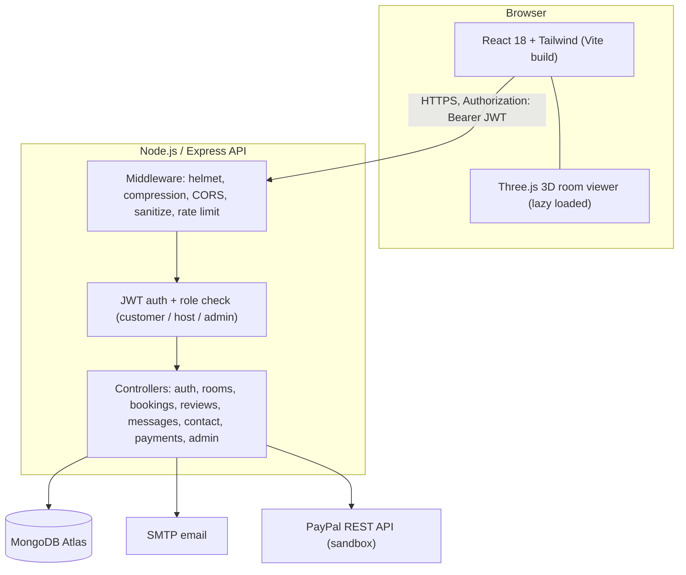
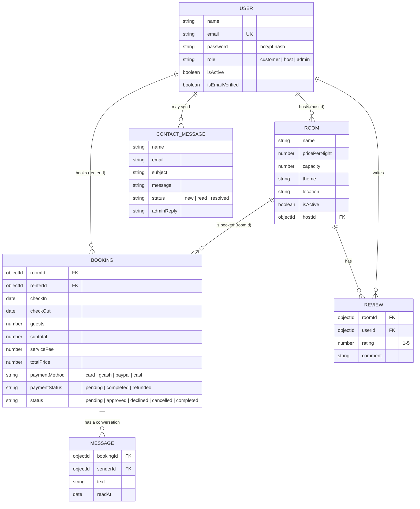
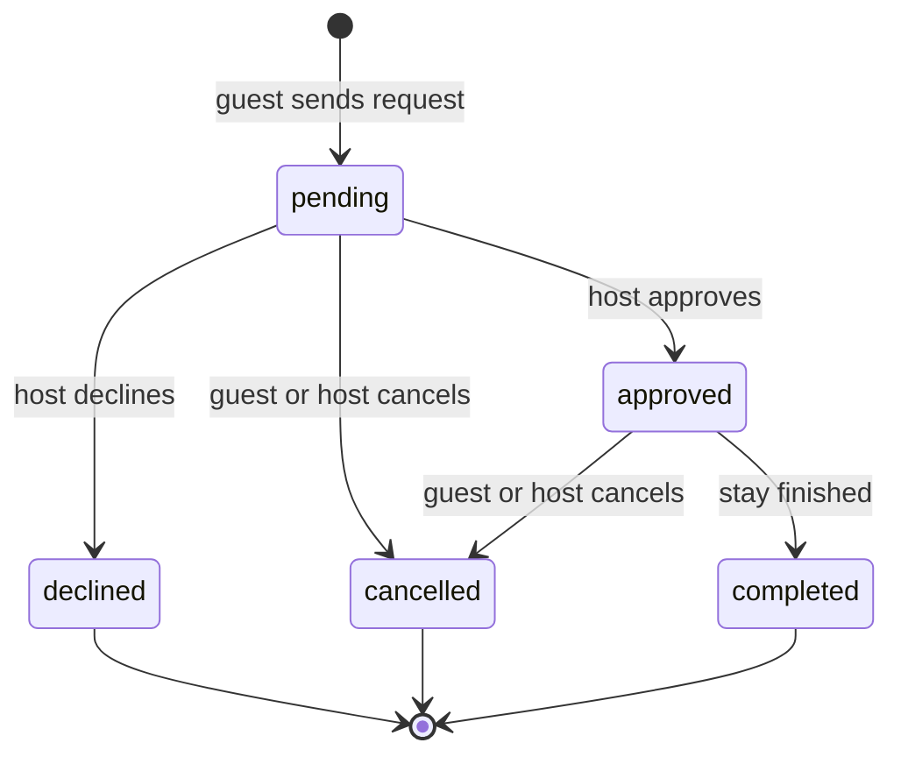
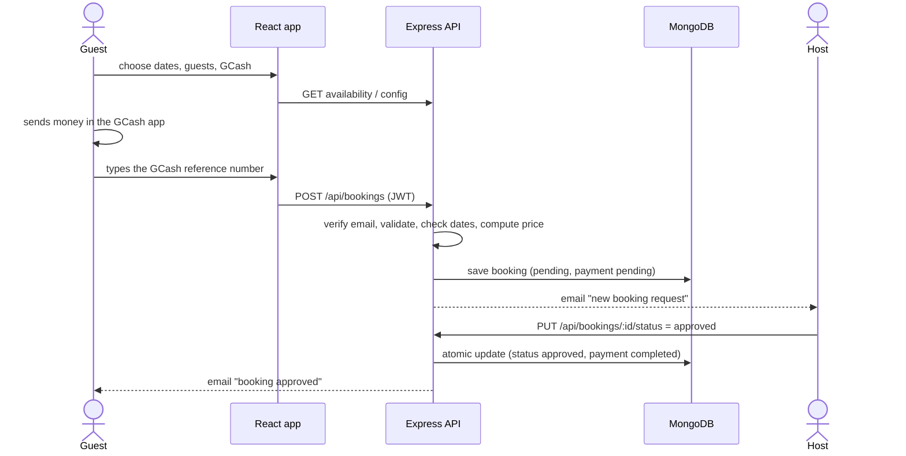

# Architecture

## System overview

## Database (MongoDB collections)

Indexes: bookings by `(roomId, checkIn, checkOut)`, `renterId`, `status`; rooms by price, capacity, theme, active/available; unique review per `(roomId, userId)`; messages by `(bookingId, createdAt)`.

## Booking lifecycle

The server enforces these transitions with one atomic database update, so a booking that was just cancelled can never be approved.

## Booking and payment flow (GCash example)

PayPal works differently: the server creates the order and sets the price, the guest approves in PayPal, and the server captures the payment, re-checks the dates, creates the booking and refunds automatically if saving fails.

## Authentication and authorisation

1. `POST /api/auth/login` checks the bcrypt hash and returns a signed JWT (30 days with "Remember me", otherwise 1 day).
2. The React app sends `Authorization: Bearer <token>` on every request.
3. `protect` verifies the token and loads the user; deactivated accounts are rejected.
4. `authorize('host', 'admin')` and similar rules decide who can use each route (RBAC).
5. Extra rules inside controllers: guests only see their own bookings, hosts only manage bookings for their own rooms, admins can manage everything.

| Role | Can do |
|------|--------|
| Customer | Browse, book, pay, cancel own bookings, message hosts, review, manage profile |
| Host | Everything a customer can, plus manage own rooms and booking requests |
| Admin | Manage users (roles, activate, ban), view stats, answer contact messages |
